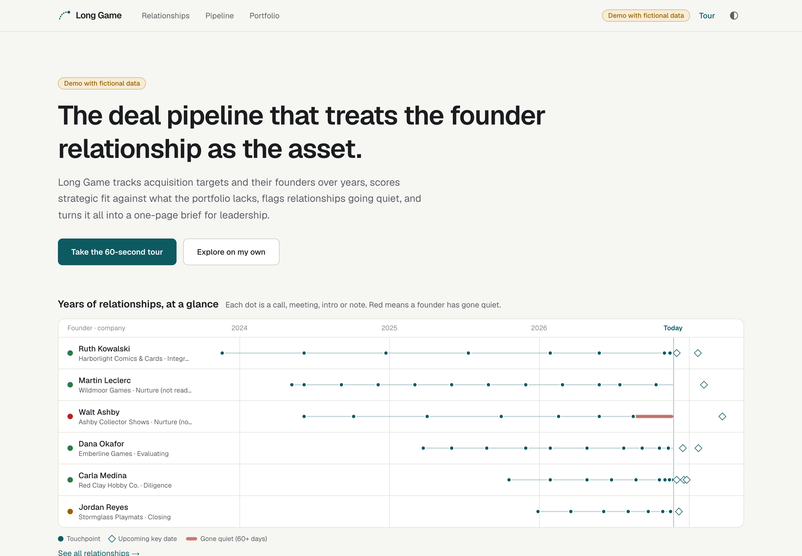
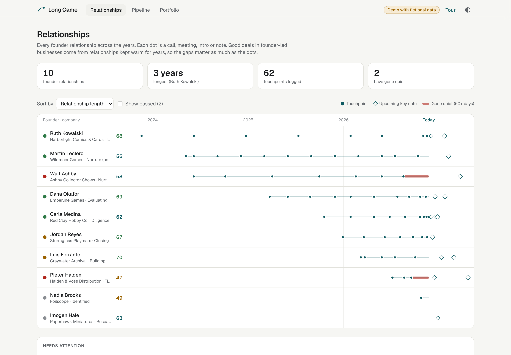
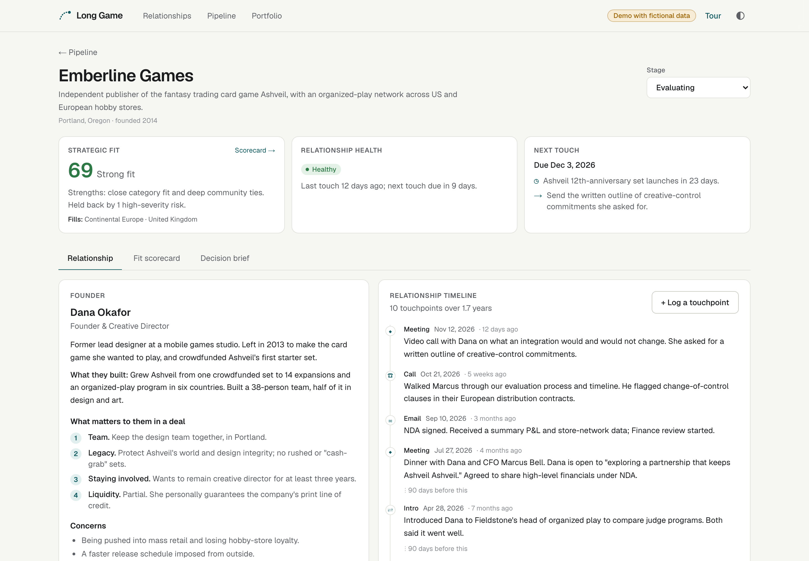
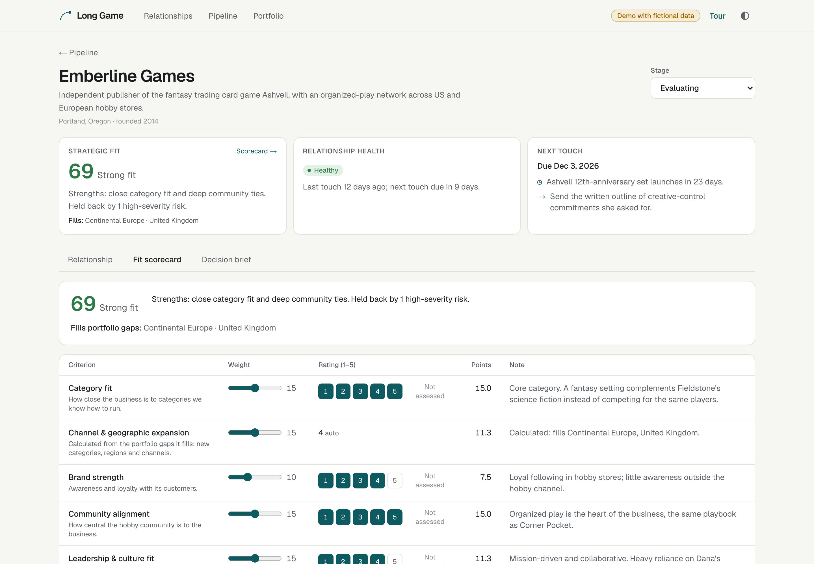
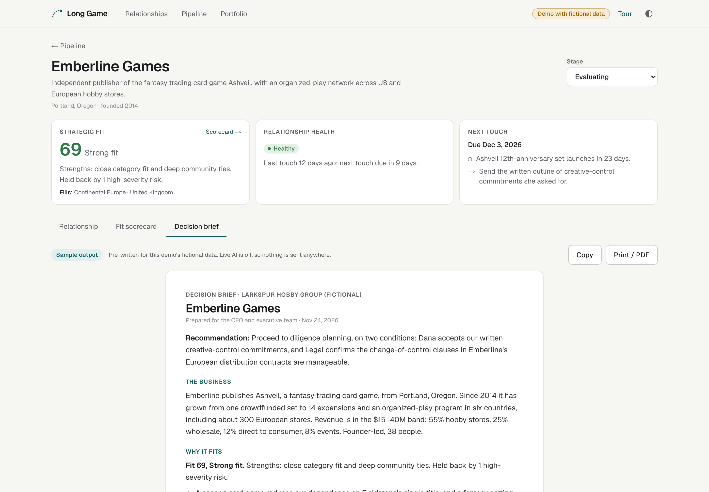
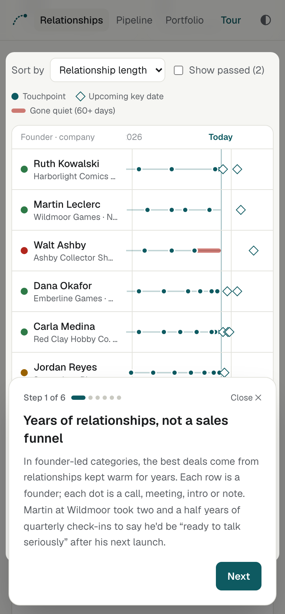

# Long Game

**The deal pipeline that treats the founder relationship as the asset.**

### [▶ Try the live demo](https://asher40121.github.io/long-game/) · no sign-up, nothing to install, about 3 minutes

*Demo with fictional data. Every company, founder and number is invented. Built independently; not affiliated with any company.*



## The problem

Corporate development teams in founder-led industries (hobby, collectibles, games) don't buy companies that are for sale. They buy companies whose founders come to trust them, often years after the first conversation, when timing changes: succession, burnout, a growth wall, a partner who wants out.

Most deal trackers are built around stages and numbers. The thing that actually decides these deals lives in a spreadsheet or one person's memory: when we last spoke, what the founder cares about protecting, and whether the business fills a real gap in the portfolio. Relationships go cold without anyone noticing, and leadership hears fit arguments as opinions.

## The insight

**Treat the relationship as the primary object and the transaction as the outcome.** Long Game tracks founders over years, tells you who has gone quiet and gives you a natural reason to call, scores fit against what the portfolio actually lacks, and turns it all into a one-page brief a CFO can decide on.

## What you can do in the demo

| | |
|---|---|
|  | **Relationship map.** Every founder relationship across the years, one dot per call, meeting, intro or note. Red marks a founder who has gone quiet. Upcoming founder key dates (a launch, an anniversary, a lease decision) show ahead of today. |
|  | **Founder-first target pages.** What the founder built, what matters to them in a deal (team, legacy, brand, liquidity, staying involved), their concerns and communication style, and the full touchpoint timeline. Log a touchpoint and relationship health updates instantly. |
|  | **Fit scorecard, measured against gaps.** Seven weighted criteria with a one-line "why". Channel and geographic expansion is calculated from the categories, regions and channels the portfolio lacks. Drag the weights and every score updates. Risk flags subtract a capped penalty. |
|  | **One-page decision brief.** Recommendation, the business, why it fits, what the founder cares about, key risks, what we don't know yet, and a next step with an owner. |

Also: **add your own companies and founders** (with upcoming key dates that appear on the map) and edit any company, a pipeline board and sortable table across 10 relationship stages (including Nurture and Passed), a **Needs attention** list, a portfolio page showing which targets fill which gaps, a 60-second guided tour, dark mode by default with a light toggle, and phone layouts.

<p align="center"></p>

## How it works

- **Relationship health** compares days since the last touch with the rhythm each stage calls for (First Conversation every 30 days, Evaluating 21, Diligence 7, Nurture 90). A relationship has **gone quiet** at 60+ days and past its rhythm. Suggestions put upcoming founder key dates first, then low-pressure reasons to reach out.
- **Fit** is a transparent weighted tally: each criterion earns *weight × (rating − 1) ÷ 4*, scaled to 100 over the criteria assessed, minus risk penalties (high 5, medium 2, low 1; at most 15). Unassessed criteria are excluded and called out, never guessed; with fewer than three criteria rated, the score is labeled **Preliminary**.
- **The demo never goes stale.** Seed dates are stored relative to "today", so whoever visits sees the same story: two founders gone quiet, a deal closing in two weeks, a launch next month.

## How AI is used, and its guardrails

Decision briefs follow a written prompt, [`docs/prompts/decision-brief.md`](docs/prompts/decision-brief.md), designed for Claude. In this public demo, **live AI is off**: each seeded target has a hand-written brief that follows the same rules, labeled **Sample output**, so visitors can try everything at no cost.

The rules, enforced by automated tests on every sample:
- **Facts only.** Every number in a brief must appear in that target's data (a short, documented list of derived figures aside). Missing information goes under "What we don't know yet", with who should find it out.
- **No conclusions outside our lane.** No price, multiple or valuation. Valuation and legal questions are inputs for Finance and Legal.
- **Consistent.** The fit line is quoted exactly from the calculated score.
- **Decision-ready.** Six sections in a fixed order, under 450 words, ending with an owned next step.

If you edit a target, the app says the sample no longer matches and offers a brief **assembled only from your data**, with gaps listed instead of invented filler. The optional live mode (planned) runs behind a server route with rate limiting and a daily spend cap; the API key never reaches the browser.

## Privacy

No accounts, no analytics, no server. Your changes are saved only in your browser's local storage. "Reset demo data" restores the original fictional data.

## Tech stack

Next.js 16 (static export) · TypeScript · Tailwind CSS 4 · Vitest (104 tests covering fit scoring, relationship health, brief truthfulness, seed integrity and storage) · GitHub Pages. Scoring and health are pure, tested functions; the UI reads them.

```bash
npm install
npm run dev          # http://localhost:3000
npm test             # unit tests
npm run build:demo   # static site in build-export/
npm run scan         # secrets scan before pushing
```

## Roadmap

- ✅ Relationship map, pipeline, founder profiles, relationship health, fit scorecard, portfolio gaps, decision briefs, guided tour, add and edit companies
- ⏳ Founder conversation prep: a 5-minute briefing, open questions, topics to avoid ([prompt draft](docs/prompts/conversation-prep.md))
- ⏳ Diligence and integration checklist that carries forward what the founder wants to preserve
- ⏳ Optional live AI with rate limiting and a daily spend cap

More: [Product brief](docs/PRODUCT_BRIEF.md) · [Architecture](docs/ARCHITECTURE.md) · [Wireframes](docs/WIREFRAMES.md) · [Changelog](CHANGELOG.md)

## About me, and why I built this

I'm **Phil Albritton**. I've worked with toy, game and collectibles brands for years, and I've been a founder myself, so I know the founder's side of the table. Long Game is how I'd organize long-term acquisition relationships: relationship first, fit against real gaps, and clear briefs for leadership.

[LinkedIn](https://www.linkedin.com/in/philalbritton/) · [GitHub](https://github.com/Asher40121)

---

MIT licensed. See [LICENSE](LICENSE).
